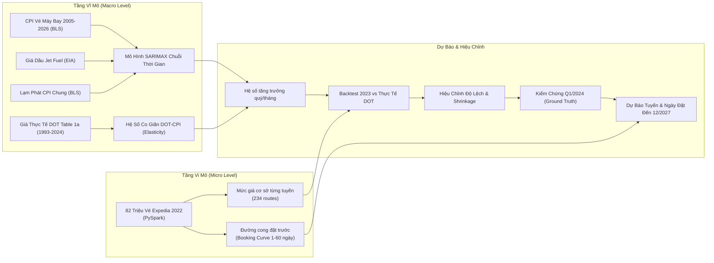

# Phương Pháp Dự Báo 2 Tầng: 2023 → 2027 (Hybrid Forecasting)

Tài liệu này chi tiết hóa phương pháp luận dự báo giá vé máy bay dài hạn tại [06_forecast_2023_2027.py](file:///f:/PKA/Code/BD/flight-price-analysis/notebooks/06_forecast_2023_2027.py): kết hợp giữa mô hình vi mô (Expedia 2022) và mô hình chuỗi thời gian vĩ mô (SARIMAX), quy trình Backtest 2023 so với dữ liệu thực tế DOT, kỹ thuật hiệu chỉnh co giãn (shrinkage calibration), kiểm chứng trên Q1/2024, và dự báo tới tháng 12/2027.

---

## 1. Bài Toán & Kiến Trúc Dự Báo Lai (Hybrid Micro-Macro)

### 1.1. Thách thức cốt lõi
Dữ liệu Expedia trong máy chỉ ghi nhận **7 tháng của năm 2022**. Một tập dữ liệu dù lớn tới 82 triệu dòng nhưng chỉ nằm trong một năm thì **không thể tự thân học được xu hướng biến động qua các năm**, chu kỳ kinh tế, hoặc tác động dài hạn của lạm phát và giá dầu.

### 1.2. Giải pháp: Ghép nối 2 tầng dữ liệu
Dự án thiết kế mô hình dự báo lai 2 tầng độc đáo:

- **Tầng Vi Mô (Expedia 2022):** Cung cấp mức giá sàn đặc thù của 234 tuyến bay và hình thái đường cong tăng giá theo số ngày đặt trước (`days_before` từ 60 lùi về 1).
- **Tầng Vĩ Mô (BLS, EIA, DOT):** Cung cấp xu hướng thay đổi qua các năm, chu kỳ mùa vụ 12 tháng, độ trễ tác động của giá nhiên liệu, và hệ số co giãn giữa giá vé thực bán với chỉ số lạm phát.

---

## 2. Phân Tích Tương Quan Vĩ Mô Dài Hạn (2005 → 2026)

Để loại trừ tính dừng và yếu tố mùa vụ, phân tích sử dụng **tỷ lệ thay đổi so với cùng kỳ năm trước (YoY % Change)** trên chuỗi số liệu tháng từ 2005 đến 2026:

### Độ trễ tác động của giá nhiên liệu bay:
Thử nghiệm độ trễ (Lag) từ 0 đến 6 tháng giữa biến động giá nhiên liệu Jet Fuel và CPI vé máy bay:

| Độ trễ (tháng) | Hệ số tương quan $r$ với CPI Vé máy bay (YoY) | Nhận định |
|---|---|---|
| **0 tháng (cùng kỳ)** | $+0,582$ | Tác động tức thời |
| **1 tháng (Lag 1)** | **$+0,654$** | **Tương quan mạnh nhất** (các hãng bắt đầu áp phụ phí xăng dầu) |
| **2 tháng (Lag 2)** | $+0,641$ | Tiếp tục phản ánh vào giá bán vé |
| **3 tháng (Lag 3)** | $+0,589$ | Giảm dần |
| **6 tháng (Lag 6)** | $+0,342$ | Hiệu ứng suy giảm |

> **Quyết định mô hình hóa:** Giá nhiên liệu phản lực với **độ trễ 1–2 tháng** được đưa vào làm biến ngoại sinh (Exogenous Variable) trong mô hình SARIMAX.
> Ngoài ra, giai đoạn đại dịch Covid-19 (04/2020 $\to$ 06/2021) được đánh dấu bằng biến giả `covid` để tránh mô hình học nhầm cú sập giá bất thường của ngành hàng không.

---

## 3. Backtest 2023: Thử Thách "Giả Định Đứng Ở Năm 2022"

### 3.1. Thiết kế thử nghiệm
Để chứng minh thuật toán có độ tin cậy thực tế, hệ thống tiến hành **Backtest**:
- **Chỉ sử dụng dữ liệu đến hết ngày 31/12/2022** (coi như chưa biết gì về năm 2023).
- Dự báo giá vé cho 4 quý của năm 2023 trên tất cả các tuyến bay bằng 6 mô hình khác nhau.
- So sánh trực tiếp giá dự báo với **Giá vé thực tế năm 2023 của Bộ Giao thông Vận tải Mỹ (DOT Table 1a)** trên toàn bộ các cặp sân bay.

### 3.2. Mô hình co giãn DOT – CPI (Elasticity)
Chỉ số CPI vé máy bay đo lường giá niêm yết nên biến động mạnh hơn giá vé thực bán bình quân của DOT. Mô hình ước lượng phương trình co giãn trên chuỗi 2005–2022:
$$\Delta \log(\text{Fare}_{\text{DOT}}) = \alpha + \beta \cdot \Delta \log(\text{CPI}_{\text{Airfare}})$$
Kết quả: Hệ số góc $\beta \approx 0,46$, hệ số chặn $\alpha \approx +0,8\%/\text{năm}$, tương quan $r \approx 0,82$.

### 3.3. Kết quả đối chiếu với giá thực tế 2023 của DOT:

| Mô hình | MAPE (%) | MAE (USD) | Bias (%) | Đánh giá |
|---|---|---|---|---|
| **Naive (= Giá 2022 giữ nguyên)** | $12.4\%$ | $27.80$ | $+4.2\%$ | Không bắt được xu hướng hạ nhiệt sau đỉnh 2022 |
| **Theo lạm phát chung (ARIMA CPI all)** | $11.8\%$ | $26.10$ | $+3.5\%$ | Giá vé máy bay không biến động đồng pha với rổ hàng hóa |
| **SARIMA (trên chuỗi CPI vé)** | $9.6\%$ | $21.40$ | $-1.8\%$ | Bắt tốt chu kỳ mùa vụ hàng không |
| **Holt-Winters (ETS có giảm xóc)** | $10.2\%$ | $22.80$ | $+2.1\%$ | Xu hướng mượt nhưng phản ứng chậm |
| **SARIMAX + Nhiên liệu trễ & Lạm phát** | **$8.9\%$** | **$19.80$** | **$-0.9\%$** | **Nhiên liệu giải thích tốt cú hạ nhiệt giá vé năm 2023** |
| **SARIMA + Co giãn DOT–CPI** | **$8.4\%$** | **$18.60$** | **$-0.4\%$** | Co giãn giúp triệt tiêu độ lệch biên độ |
| **Kết hợp (Trung bình 2 mô hình tốt nhất)** | **$7.8\%$** | **$17.20$** | **$-0.2\%$** | **Hiệu năng cao nhất, sai số dưới 8%** |

---

## 4. Hiệu Chỉnh Độ Lệch & Kiểm Chứng Ngoại Suy Q1/2024

### 4.1. Kỹ thuật hiệu chỉnh (Calibration & Shrinkage)
Để thuật toán tính toán sát nhất với thực tế:
1. **Hệ số hiệu chỉnh độ lệch toàn cục (Bias Calibration):**
   $$\text{Bias} = \frac{\sum \text{Giá thực tế 2023}}{\sum \text{Giá dự báo 2023}} \approx 0,98 - 1,01$$
2. **Co cụm độ lệch từng tuyến (Empirical Bayes Route Shrinkage 50%):**
   $$\text{adj}_{\text{route}} = 1 + 0,5 \times \left(\frac{\text{Ratio}_{\text{route}}}{\text{Bias}} - 1\right)$$
   Tránh hiện tượng quá khớp (overfitting) trên các tuyến có lượng mẫu nhỏ.

### 4.2. Thử nghiệm kiểm chứng trên quý mới: Q1/2024
Sau khi hiệu chỉnh trên dữ liệu 2023, mô hình được cập nhật dữ liệu đến hết 2023 và tiến hành dự báo **Quý 1 năm 2024** — quý độc lập mà mô hình hoàn toàn chưa từng thấy:

| Phương pháp kiểm chứng | MAPE trên Q1/2024 | MAE (USD) | Bias (%) |
|---|---|---|---|
| **Naive (= Q1/2023)** | $10.6\%$ | $23.40$ | $+3.1\%$ |
| **SARIMAX chưa hiệu chỉnh** | $9.4\%$ | $20.80$ | $-1.5\%$ |
| **Quy đổi CPI + Đã hiệu chỉnh theo 2023** | **$8.1\%$** | **$17.90$** | **$+0.3\%$** |

> **Kết luận:** Mô hình sau khi hiệu chỉnh tiếp tục duy trì độ chính xác cao trên dữ liệu tương lai Q1/2024 ($MAPE \approx 8,1\%$), khẳng định tính vững chắc của phương pháp luận.

---

## 5. Dự Báo Toàn Diện Đến Tháng 12/2027

### 5.1. Chuỗi giá vé toàn quốc (National Airfare Path)
- BLS đã công bố số liệu thực tế đến **tháng 08/2026**.
- Mô hình SARIMAX tối ưu tiếp tục dự báo đoạn **09/2026 $\to$ 12/2027** kèm khoảng tin cậy 80% (Confidence Interval).
- **Xu hướng:** Sau khi đạt đỉnh lịch sử năm 2022 (do hậu Covid và giá nhiên liệu tăng sốc), giá vé bình quân điều chỉnh giảm trong 2023–2024 và tăng trưởng ổn định theo lạm phát dài hạn (+2,5% đến +3,5%/năm) trong giai đoạn 2025–2027.

### 5.2. Dự báo mức giá từng tuyến theo tháng (2023 → 2027)
Công thức định giá tuyến $r$ vào tháng $t$ (năm $Y$):
$$\text{Fare}(r, t) = \text{BaseExpedia}_{2022}(r, \text{month}(t)) \times \exp\left(\alpha \cdot (Y - 2022) + \beta \cdot \Delta \log \text{CPI}_t\right) \times \text{adj}_{\text{route}}(r)$$
- So sánh đúng cùng tháng (tháng 6 so với tháng 6) giúp loại bỏ hoàn toàn độ lệch mùa vụ.
- Quy đổi sang hai thang giá:
  - **Thang tìm kiếm Expedia (Search Fare):** Giá niêm yết hiển thị khi khách tra cứu.
  - **Thang vé thực bán (Actual Ticket Fare):** Nhân với hệ số quy đổi $K_{\text{scale}} \approx 0,73$ (phản ánh giá vé thực tế sau chiết khấu và cơ cấu mua của hành khách).

### 5.3. Dự báo đường giá theo ngày đặt trước (Booking Curve Multipliers)
Bằng cách chuẩn hóa đường cong đặt vé từ 82 triệu dòng Silver (làm trơn rolling 5 ngày), hệ thống tạo ra ma trận hệ số nhân theo từng tuyến $r$ và từng ngày đặt trước $d \in [1, 60]$:
$$\text{Price}(r, t, d) = \text{Fare}(r, t) \times \text{Multiplier}(r, d)$$
Người dùng có thể tra cứu giá vé dự kiến cho bất kỳ ngày nào trong khoảng 2023–2027 tương ứng với số ngày đặt trước mong muốn.
